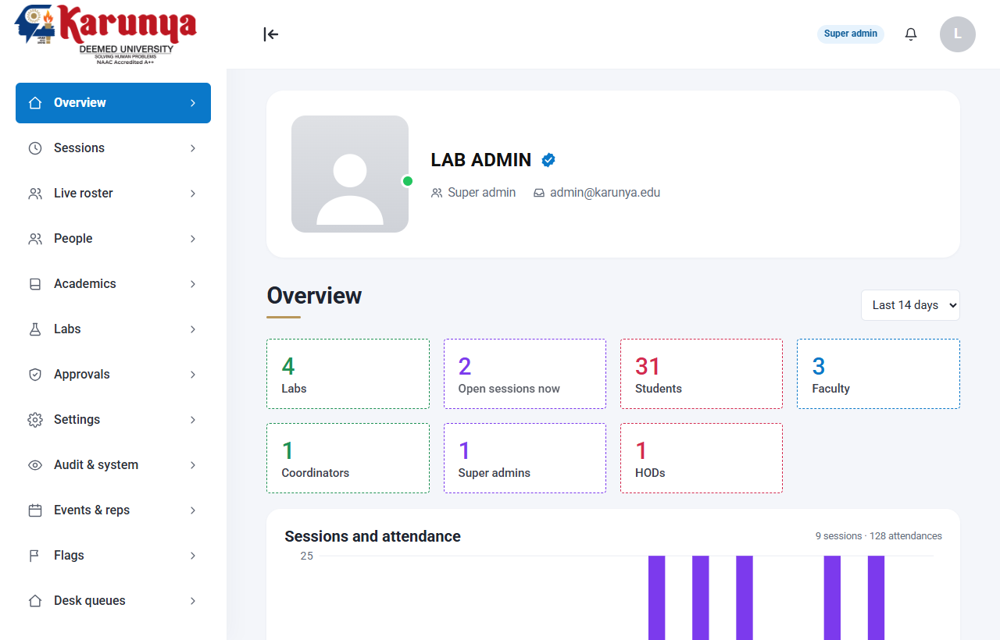

# LABFLOW

Multi-laboratory management for a university CSE division: device-bound reverse-QR attendance, sessions and timetable, inventory/kits/loans/bookings, reports, and a tamper-evident audit log. Google Apps Script (V8) web app, Google Sheets as the database, Drive/Docs for photos and reports, Gmail for notifications.

Four role dashboards (student, faculty, lab staff, super admin) plus a kiosk mode. Every action goes through one `rpc(action, payload)` gateway that checks the role on the server; the UI hides things but never decides.



## Read this first: what is and is not verified

| Verified here (automated, on in-memory fakes of the Apps Script services) | NOT verified: needs your Workspace deployment |
|---|---|
| 167 backend tests run the real `.gs` files in a Node `vm` | `Session.getActiveUser()` behaviour for your two domains (see Authentication) |
| 75 browser checks (Playwright + real Chromium WebCrypto/IndexedDB) against the real server code, including all 10 site themes | HtmlService iframe: IndexedDB key persistence, `getUserMedia`, `BarcodeDetector` |
| Real P-256 signature verification, QR render, replay refusal, mobile overflow | Real latency, `LockService` throughput, quotas, trigger runs |

Details and exact counts: [TEST_PLAN.md](TEST_PLAN.md). Nothing in this repo has been run against a live Google account.

The [critical workflow audit](docs/workflow-audit.md) adds 29 regression cases and fixes attendance races, booking/fulfilment checks and interrupted-return recovery. Backend checks, all 27 local scenarios and the 75 browser checks pass on the merged code.

## Authentication: the blocker you must check

The manifest is `executeAs: USER_DEPLOYING`, `access: DOMAIN`. In that mode `Session.getActiveUser().getEmail()` returns the visitor's address **only when the visitor is in the same Workspace domain as the deployer**. For anyone else it returns an empty string.

Consequences for Karunya:

- Karunya uses two domains, `karunya.edu` and `karunya.edu.in`. If they are **separate Workspace tenants** (or one is only an alias/secondary domain whose users are not in the deployer's organisation), users of the other domain will get a blank email and be refused with `NO_IDENTITY`. The app fails closed. There is no workaround in this code, by design: it never trusts an email, role or roll number sent from the browser, and has no passwords.
- If both domains belong to **one** Workspace organisation (primary plus secondary/alias domain), it should work for both. Confirm it, do not assume it.
- Deploy from an account inside that organisation. A personal `@gmail.com` deployer cannot serve `@karunya.edu` users at all.

How to check, in 5 minutes, before anything else: deploy, then open the web app as one ordinary user from each domain. A user who lands on the "No identity" error screen is affected. `setupSelfTest()` only runs as the owner, so it cannot test other users.

If it fails for one domain, your options are administrative, not code: (a) have IT put both domains in one organisation, or (b) deploy as "execute as user accessing the app". Option (b) was rejected here because it requires every user to have access to the database spreadsheet, which defeats the backend authorisation. Option (b) is a design change, not a flag flip.

## Deploy

1. Create a Google Apps Script project owned by an account in the Karunya Workspace. Copy everything in `src/` into it (or use `clasp`; `.clasp.json` is git-ignored). `appsscript.json` carries the scopes and web-app settings.
2. In the editor run, in order:
   - `setupInitialise()`: creates the "LABFLOW Database" spreadsheet, all sheets and headers, and the QR secret. Idempotent; refuses (`SCHEMA_MISMATCH`) rather than altering mismatching sheets.
   - `setupBootstrapAdmin('you@karunya.edu')`: the first admin. Only honoured while no active admin exists.
   - `setupSelfTest()`: checks platform assumptions with real timings (P-256 verify time, lock behaviour, identity). Read its output.
   - `setupInstallTriggers()`: installs exactly four time-driven triggers (every 5 min session tick, hourly email digest, 01:00 nightly, 08:00 morning).
3. Deploy > New deployment > Web app. Execute as: Me. Who has access: Anyone within the organisation.
4. Sign in as the bootstrap admin. Add labs, courses, users, rosters and timetable (admin pages). CSV import is available for users and students.
5. **Kiosks:** Admin > Labs > Kiosks. A kiosk is a dedicated Google account (for example `iot-lab-kiosk@karunya.edu`) mapped to one lab. Sign in with that account on the lab PC/tablet. Kiosk accounts can only call `kiosk.ping` and `kiosk.scan`.
6. Students open the web app on their phone once, open "My device", run the compatibility check, and register the device. Registration of a second or replacement device requires in-person approval by lab staff.

Setup functions are not routed through `rpc`, and `ownerOnly_()` also rejects anyone but the script owner.

## How attendance works (short version)

1. The student's phone holds a non-extractable ECDSA P-256 key (WebCrypto, stored in IndexedDB). The public key is registered after a server challenge.
2. To check in, the phone asks the server for a challenge bound to student, credential, session and lab, signs it, and shows a QR for about 60 seconds.
3. The kiosk scanner reads the QR and sends it to the server. The server checks the HMAC token, the signature, freshness, the open session, the lab, enrolment, revocation, and consumes the code once (Redemptions sheet plus cache nonce, under a lock).
4. Events are append-only (IN, OUT, RESCAN, corrections, voids, decisions, spot checks). Summaries are derived and rebuildable. A missing exit scan never credits the full session.
5. Physical controls complement the crypto: random rescan windows, faculty spot checks against the photo on file, exit scans, "exit not scanned" flags, audited manual corrections (older than 24 h need admin approval), per-user rate limits.

The residual risks (live QR relay, device compromise, collusion) are stated in [SECURITY.md](SECURITY.md). Do not describe this as "proof of presence".

## Device and camera compatibility

Student phones need: WebCrypto ECDSA, IndexedDB, and storage that persists. The "My device" page runs a real check (key generation, signing, IndexedDB write/read) and shows exactly which part fails. Known limitation: Safari/iOS can evict site storage, which loses the key. The app then requires re-registration, which needs desk approval. Keys are non-extractable but are **not** claimed to be hardware-backed.

Kiosk input, in order of preference: a USB/Bluetooth keyboard-wedge QR scanner (types the code and Enter), then the camera (`BarcodeDetector`, Chromium-based browsers; if missing the kiosk says so), then a paste box. A student whose device cannot register uses the desk's audited manual attendance exception.

## Local development and tests

```
npm install
npm run build      # vendors @noble/curves + qrcode-generator, compiles Tailwind into src/Styles.html
npm run check      # syntax lint of every .gs/.html script + 167 backend tests
npm run dev        # http://localhost:8787/   (local demo account picker)
npm run e2e        # Playwright browser flow (needs Chromium; screenshots in .build/shots)
```

The dev server runs the real `.gs` files against in-memory fakes of SpreadsheetApp, CacheService, LockService, etc., and injects a mock `google.script.run`. Opening `http://localhost:8787/` shows a local demo account picker. Choose a seeded profile or enter a Karunya email, then use the Account menu to switch demo accounts or sign out. This only selects a simulated test identity; it does **not** sign in to Google, verify ownership of an email, or change production authentication. `?as=` remains available as a direct local testing shortcut; production has no such parameter. The fakes prove logic, not Google's behaviour.

### Try the seeded demo

Run `npm run dev`, then open [http://localhost:8787/lab](http://localhost:8787/lab). In **Overview**, choose a preset and use **Rebuild world** to reset the demo data. The presets seed 12, 30 or 60 rostered students, plus a separate pending-verification sample, with attendance history, and include:

- An open class with live attendance, an event/workshop, a class representative and a student coordinator.
- Labs, kiosks, courses, timetables, inventory, kits and a project group.
- A pending student verification, equipment request and research visit; a flagged check-in and a pending spot check.
- Current and overdue loans, pending/approved/rejected bookings, and a workshop with registered students and a guest.
- Local app links for the admin, faculty, staff, student and kiosk roles. Direct local testing links are also available, for example `http://localhost:8787/?as=admin@karunya.edu` or `http://localhost:8787/?as=student1@karunya.edu`.

The demo lives only in memory. Rebuilding it or restarting the dev server discards its data; nothing is written to Google Sheets or a deployed app.

## Layout

- `src/*.gs`: server (Config, Db, Auth, Users, DeviceCredential, Session, Attendance, Asset, Booking, Lab, Report, Audit, Notification, Trigger, Admin, Setup, Code = router). `Vendor_P256.gs` is a bundled verifier.
- `src/Index.html`, `Styles.html` (generated), `SharedComponents.html`, `Scripts*.html`: UI. No `innerHTML` of data anywhere; DOM is built with an `h()` helper.
- `test/`: backend tests, fixtures, harness; `test/e2e/` browser flow.
- `docs/screens/`: screenshots produced by the E2E.

## Credits, licences, design reference

- UI direction (colours, display type, sharp cards, lime accent) is inspired by https://github.com/Kukyos/DayFlowOdoo. **No code, markup or assets were copied from it**, it is not a dependency, and it was not modified or pushed to. That repository has no LICENSE file, so only the general visual language is reused.
- Fonts (Anton, Instrument Serif, Inter) load from Google Fonts at runtime; they are SIL OFL.
- `@noble/curves` (MIT), `qrcode-generator` (MIT), Tailwind CSS (MIT, compiled output only).
