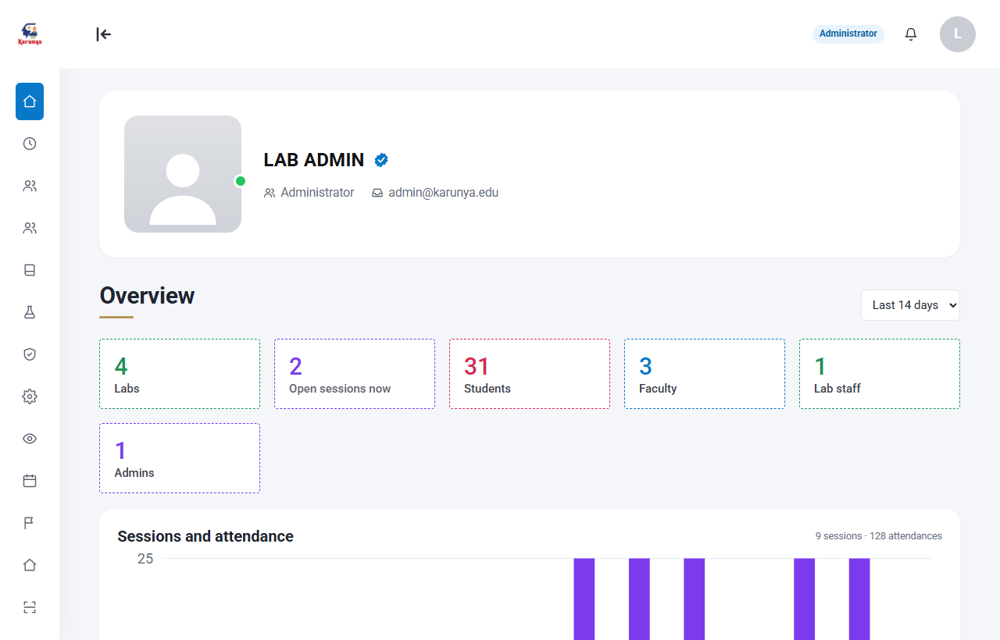
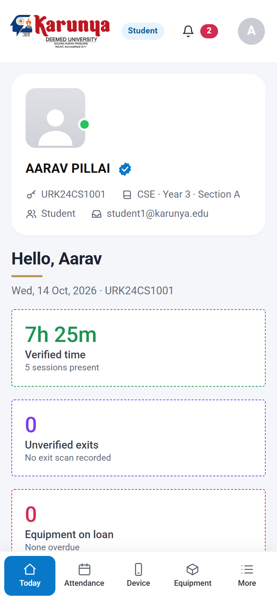
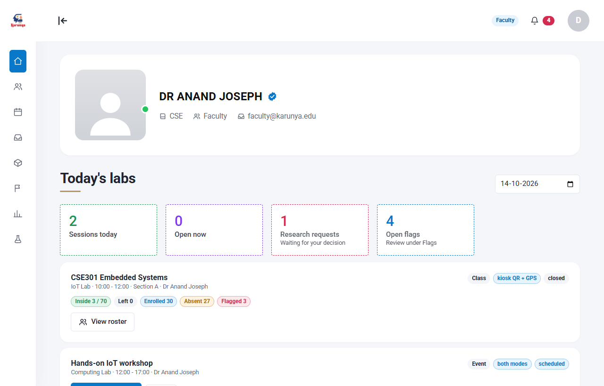
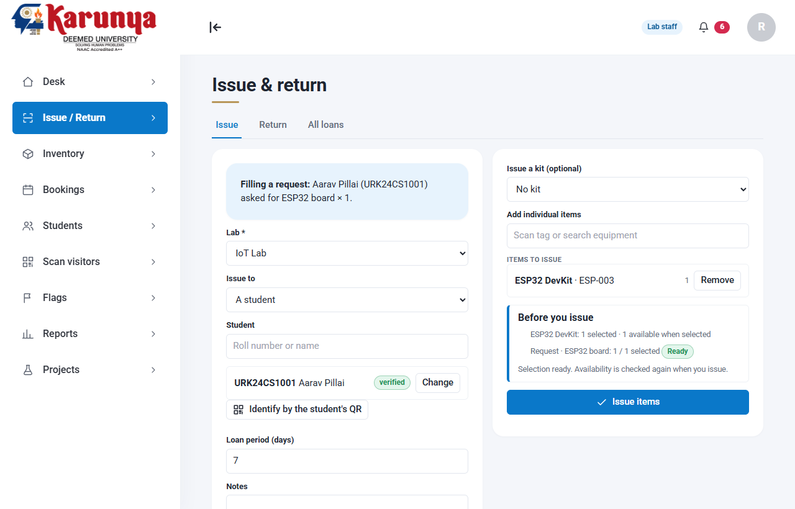
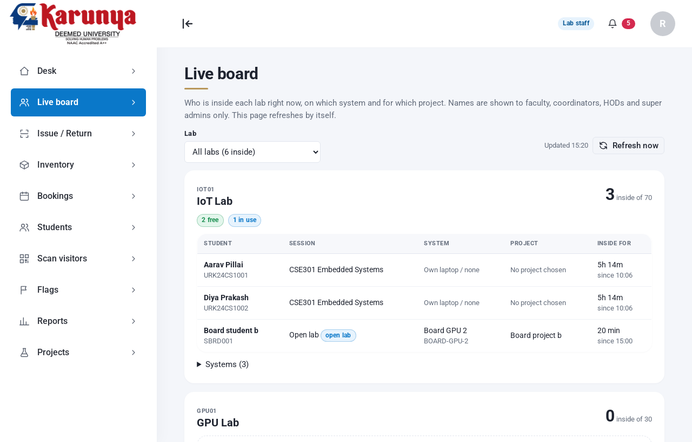
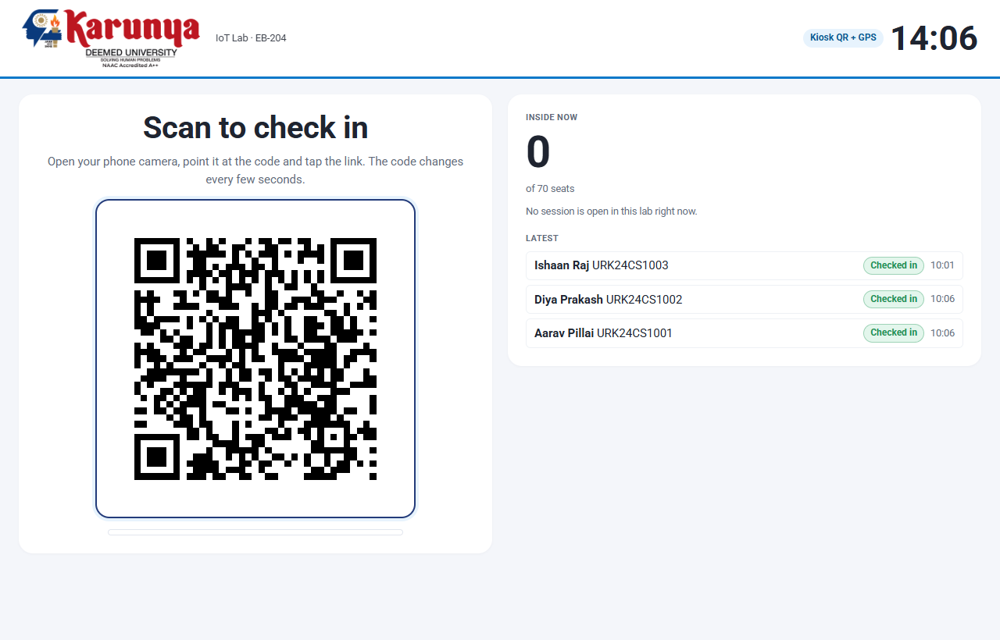

# LABFLOW

Multi-laboratory management for a university CSE division: device-bound reverse-QR attendance, sessions and timetable, inventory/kits/loans/bookings, reports, and a tamper-evident audit log. Google Apps Script (V8) web app, Google Sheets as the database, Drive/Docs for photos and reports, Gmail for notifications.

Five role dashboards (student, faculty, coordinator, super admin and HOD) plus a kiosk mode. Every action goes through one `rpc(action, payload)` gateway that checks the role on the server; the UI hides things but never decides.



## Features

- **Three tiers of proxy protection**: kiosk QR with a GPS geofence and random location checks (tier 1, the SRS version), a device-bound signed QR scanned in the room (tier 2), or the LABFLOW Android app, which confirms the student stays at the lab for the whole session with signed location reports and random fingerprint checks (tier 3). Nobody is refused for a location problem; it is flagged for the faculty. Rescan windows, spot checks, exit scans and flags back them up. See [Attendance](docs/attendance.md) and [Phone app](docs/phone-app.md).
- **Open lab for extra hours**: daily walk-in sessions, project and system selection at the door, automatic sign-out at closing.
- **Live board**: who is inside each lab, on which system and project, for staff and HOD; head counts only for students.
- **Equipment**: inventory, kits, group issues, loans and returns on a handshake screen, time-slot bookings with a waitlist, overdue reminders.
- **Projects**: supervisor approval, timeline and recorded outcomes, linked to the hours students log.
- **Reports**: daily digest, monthly audit, custom range, per-student and per-system usage, session log and ERP export as CSV or PDF.
- **Roles**: student, faculty, coordinator, HOD (read-only, department-scoped) and super admin, all enforced on the server.
- **Data protection**: mobile numbers sealed with AES-256-GCM, a hash-chained audit log, nightly Drive backups, and a yearly archive that keeps the live sheet small. See [SECURITY.md](SECURITY.md).
- **Ten site themes** chosen by the super admin. See [Themes](docs/themes.md).

## The role dashboards

| Role | Sees | Screenshot |
|---|---|---|
| **Student** | Today, Attendance, Device, Equipment, Research visits, Class rep, My reports with days and hours per lab |  |
| **Faculty** | Today, Live roster with who is missing, spot checks, Plan, Students, Equipment, Flags, Reports |  |
| **Coordinator** (staff) | Desk, Issue / Return, Inventory, Bookings, Students and course rosters, Scan visitors, Flags, Reports |  |
| **Super admin** | Overview, People, Academics, Labs, Approvals, Settings, Audit and system (backups, yearly archive), Events, Flags |  |
| **HOD** | Read-only department overview, facilities, live board and scoped reports |  |
| **Kiosk** (a dedicated account per lab) | The rotating QR in Mode A, a scanner in Mode B |  |

## Quick start (on a laptop, no Google account)

```
npm install
npm run build        # one time: vendored libraries and compiled CSS
npm run dev          # http://localhost:8787/  (pick a demo account)
```

Open [http://localhost:8787/lab](http://localhost:8787/lab) for the Test Lab. It opens on **Quick check-in**: the labs on a map with their geofences, and a one-click check-in for any student in any lab, no accounts needed. The other sections rebuild the world and try a full class, an attack or a theme. `npm run demo:page` builds the same demo as one self-contained page (`.build/labflow-demo.html`) that runs the real server code and app in the browser, for sharing without a server. `npm run check` runs the lint and all backend tests; `npm run sim` runs the 27 scenarios. To put it on Google, follow [Deployment](docs/deployment.md).

## Documentation

| Page | What is in it |
|---|---|
| [Architecture](docs/architecture.md) | Gateway, services, front ends, background jobs |
| [Attendance](docs/attendance.md) | The three tiers, the verification pipelines, the event log, verified time |
| [Phone app](docs/phone-app.md) | Tier 3: install the Android app, set a lab's location, how results are worked out |
| [Data model](docs/data-model.md) | The 39 sheets and how the schema is defined |
| [Deployment](docs/deployment.md) | Setup in order, hosted app, secrets to keep |
| [Testing](docs/testing.md) and [TEST_PLAN](TEST_PLAN.md) | What is tested, how, and what only a deployment can show |
| [Themes](docs/themes.md) | Pick a theme, what each changes, how to add one |
| [Traceability](docs/traceability.md) | R1 to R18 and FR-1 to FR-39 mapped to tests |
| [Requirements](docs/requirements.md), [Tasks](docs/tasks.md), [Progress](docs/progress.md) | The brief, open work, the log |
| [Open lab](docs/openlab.md), [Work selection](docs/work-selection.md), [Live board](docs/live-board.md), [Projects](docs/projects.md), [Reports](docs/reports.md), [HOD access](docs/hod-access.md), [Unnati demo](docs/unnati-demo.md), [Presenting](docs/presenting.md), [Workflow audit](docs/workflow-audit.md) | Feature pages |

## Read this first: what is and is not verified

| Verified here (automated, on in-memory fakes of the Apps Script services) | NOT verified: needs your Workspace deployment |
|---|---|
| 369 backend tests run the real `.gs` files in a Node `vm` | `Session.getActiveUser()` behaviour for your two domains (see Authentication) |
| 85 general browser checks, 33 focused issue checks, 27 project checks, 15 open-lab checks, 23 work-selection checks, 15 automatic sign-out checks, 26 live-board checks, 17 report checks, 22 HOD checks, 36 session-workflow checks, 10 recovery checks, 15 readiness checks and 17 identity checks (Playwright + real Chromium WebCrypto/IndexedDB) against the real server code, including all 10 site themes | HtmlService iframe: IndexedDB key persistence, `getUserMedia`, `BarcodeDetector` |
| Real P-256 signature verification, QR render, replay refusal, mobile overflow | Real latency, `LockService` throughput, quotas, trigger runs |
| Phone app (tier 3): 6 backend tests and 11 browser checks with the app simulated in Node (same keys, messages and `/exec` calls); the APK builds and its signature format passes a unit test | The APK on a real Android phone: background reports with the screen locked, fingerprint prompt, battery killers, the Apps Script redirect from the app |

Details and exact counts: [TEST_PLAN.md](TEST_PLAN.md). Automated runs use local fakes. The repo records an initial live setup on 21 Oct; see the dated snapshot and remaining physical checks in [Presenting](docs/presenting.md).

The [critical workflow audit](docs/workflow-audit.md) adds 29 regression cases and fixes attendance races, booking/fulfilment checks and interrupted-return recovery. Backend checks, all 27 local scenarios and 84 browser checks pass, including the staff return form's live balances, validation, return-all shortcut and safe retry after an uncertain response.

The [session workflow audit](docs/session-workflow-audit.md) adds five backend regressions and 36 browser checks for per-session modes, manual rescans and onboarding. It fixes imported-email claim blocking, partial account writes, stale identity during concurrent claims, final-lock mode checks and the faculty dialog overriding rescan policy.

The [identity audit](docs/identity-audit.md) covers reference photos and replacement-device approval. It restores the desk upload route, checks current photo/claim permissions under the lock and rejects replacement approvals for disabled/unverified students or demoted operators.

The issue screen adds a request/kit checklist, combined stock validation, booking collection guidance and an action to open the new loan for return. Its 33 focused browser checks also cover stale responses, multi-unit kits and retrying an uncertain checkout without changing the original payload.

Students can now create individual or group projects, choose a supervisor and timeline, and submit outcomes after approval. Supervisors review outcomes; coordinators and super admins can approve or reject projects. See [Projects](docs/projects.md) for permissions, retry behaviour and department-scoped HOD reads.

Super admins can enable daily Open lab sessions in lab settings. Verified students can walk in during opening hours without a booking, and regular classes continue alongside them. See [Daily open lab](docs/openlab.md); students can now choose a project/system and change it while inside. Automatic sign-out credits open-lab visits through closing and marks them in history; see [Project and system selection](docs/work-selection.md).

Faculty, staff and admin can open **Live board** to see current visitors, projects and systems across labs, with automatic updates and workstation availability. Student availability responses contain no occupant identities. HOD access is read-only and restricted to its department plus shared labs; see [Live board](docs/live-board.md).

Reports now include student hours/days/visits/auto sign-outs, per-system use and supervised project outcomes/hours, with CSV/PDF exports. Student Today shows per-lab days and hours for the past 90 days. Reservations and loans stay separate from verified attendance; see [Reports](docs/reports.md).

Super admins can assign the HOD role and account/lab departments. HOD accounts have an overview, read-only facilities, live board and scoped reports. A blank lab department means shared; a HOD with no department sees shared labs only. See [HOD access](docs/hod-access.md).

Super admins can open **Audit & system → System health → Lab readiness** to review door GPS, walk-in hours/projects, recent kiosk activity, teaching sessions, workstation counts, HOD setup and backup recency. These are configuration checks; they do not replace a phone check-in and an outside-geofence rehearsal.

## Authentication: the blocker you must check

The manifest is `executeAs: USER_DEPLOYING`, `access: ANYONE_ANONYMOUS`; the server refuses any call it cannot tie to an allowed Google account. There are two ways in (see [Deployment](docs/deployment.md)): the Apps Script page, which uses `Session.getActiveUser().getEmail()`, and the hosted app, which uses Google sign-in. On the Apps Script page `getActiveUser()` returns the visitor's address **only when the visitor is in the same Workspace domain as the deployer**. For anyone else it returns an empty string.

Consequences for Karunya:

- Karunya uses two domains, `karunya.edu` and `karunya.edu.in`. If they are **separate Workspace tenants** (or one is only an alias/secondary domain whose users are not in the deployer's organisation), users of the other domain will get a blank email and be refused with `NO_IDENTITY`. The app fails closed. There is no workaround in this code, by design: it never trusts an email, role or roll number sent from the browser, and has no passwords.
- If both domains belong to **one** Workspace organisation (primary plus secondary/alias domain), it should work for both. Confirm it, do not assume it.
- Deploy from an account inside that organisation. A personal `@gmail.com` deployer cannot serve `@karunya.edu` users at all.

How to check, in 5 minutes, before anything else: deploy, then open the web app as one ordinary user from each domain. A user who lands on the "No identity" error screen is affected. `setupSelfTest()` only runs as the owner, so it cannot test other users.

If it fails for one domain, your options are: (a) have IT put both domains in one organisation, (b) use the hosted app, where Google sign-in does not depend on the deployer's domain, or (c) deploy as "execute as user accessing the app". Option (c) was rejected here because it requires every user to have access to the database spreadsheet, which defeats the backend authorisation. Option (c) is a design change, not a flag flip.

## Deploy

This is the short version. The full steps, including the hosted app and the secrets to keep, are in [docs/deployment.md](docs/deployment.md).

1. Create a Google Apps Script project owned by an account in the Karunya Workspace. Copy everything in `src/` into it (or use `clasp`; `.clasp.json` is git-ignored). `appsscript.json` carries the scopes and web-app settings.
2. In the editor run, in order:
   - `setupInitialise()`: creates the "LABFLOW Database" spreadsheet, all sheets and headers, and the QR secret. Idempotent; refuses (`SCHEMA_MISMATCH`) rather than altering mismatching sheets.
   - `setupBootstrapAdmin('you@karunya.edu')`: the first admin. Only honoured while no active admin exists.
   - `setupSelfTest()`: checks platform assumptions with real timings (P-256 verify time, lock behaviour, identity). Read its output.
   - `setupInstallTriggers()`: installs exactly five time-driven triggers (every 5 min session tick, hourly email digest, 01:00 nightly, 08:00 morning, 18:00 evening digest).
3. Deploy > New deployment > Web app. Execute as: Me. Who has access: as `appsscript.json` says (`ANYONE_ANONYMOUS`; the server refuses calls it cannot tie to an allowed account).
4. Sign in as the bootstrap admin. Add labs, courses, users, rosters and timetable (admin pages). CSV import is available for users and students.
5. **Labs:** Admin > Labs & kiosks > Edit. Set the lab's GPS (stand in the room and press **Use this device's location**), the geofence radius (20 to 30 m) and the check-in mode (A, B or AB; the phone app needs A). See [Set up a lab's location](#set-up-a-labs-location).
6. **Kiosks:** Admin > Labs > Kiosks. A kiosk is a dedicated Google account (for example `iot-lab-kiosk@karunya.edu`) mapped to one lab. Sign in with that account on the lab PC/tablet. Kiosk accounts can only call `kiosk.ping` and `kiosk.scan`.
7. Students open the web app on their phone once, open "My device", run the compatibility check, and register the device. Registration of a second or replacement device requires in-person approval by lab staff. For phone-app sessions they also install the Android app; see [The phone app](#the-phone-app-tier-3).

### Updating a live deployment

After pulling new code (for example the phone app, which adds two sheets and four columns):

```
npx @google/clasp push --force                        # copies src/ to the Apps Script project
# in the Apps Script editor: run setupInitialise()     # adds new sheets and appended columns; never touches existing data
npx @google/clasp create-deployment -i <deployment id> # new version, same /exec URL
npx vercel deploy --prod --yes                         # the hosted site (sign-in, link-code screen)
```

Then open the site once as admin and check Settings shows the "Phone app (tier 3)" group.

Setup functions are not routed through `rpc`, and `ownerOnly_()` also rejects anyone but the script owner.

## How attendance works (short version)

There are three tiers of proxy protection; the faculty pick one when they open a session (Today > Open > "How students check in"):

| Tier | Check-in | After check-in |
|---|---|---|
| 1 | Scan the rotating code on the lab screen with the phone camera; the browser sends a GPS reading | While the LABFLOW page stays open, it reports the location at random times (5 to 15 minutes apart); the faculty can call a rescan |
| 2 | The phone shows a QR signed by its registered key; the kiosk or a teacher's phone scans it | Rescans and photo spot checks called by the faculty |
| 3 | The LABFLOW Android app scans the lab screen | The app reports the location every 2 minutes until the end, also with the screen locked, and asks for a fingerprint twice at random times |

**Nobody is refused for a location problem.** A check-in from outside the lab, with a faked or impossible location, or with an old forwarded code is recorded and flagged; a flagged student is not counted as present until the faculty decide (dismiss the flag, or Live roster > Actions > Override the result). Students without the app (iPhones) check in through tier 1 or 2 in a tier-3 session and are flagged "no app".

Tier 2 in more detail:

1. The student's phone holds a non-extractable ECDSA P-256 key (WebCrypto, stored in IndexedDB). The public key is registered after a server challenge.
2. To check in, the phone asks the server for a challenge bound to student, credential, session and lab, signs it, and shows a QR for about 60 seconds.
3. The kiosk scanner reads the QR and sends it to the server. The server checks the HMAC token, the signature, freshness, the open session, the lab, enrolment, revocation, and consumes the code once (Redemptions sheet plus cache nonce, under a lock).
4. Events are append-only (IN, OUT, RESCAN, corrections, voids, decisions, spot checks). Summaries are derived and rebuildable. A missing exit scan never credits the full session.
5. Physical controls complement the crypto: unannounced rescan windows called by the faculty, faculty spot checks against the photo on file, exit scans, "exit not scanned" flags, audited manual corrections (older than 24 h need admin approval), per-user rate limits.

The residual risks (live QR relay, device compromise, collusion) are stated in [SECURITY.md](SECURITY.md). Do not describe this as "proof of presence".

## The phone app (tier 3)

The Android app in `android/` confirms a student stays in the lab for the whole session. Full guide: [docs/phone-app.md](docs/phone-app.md).

**What it does.** One phone per student (a later phone needs a teacher's approval). The student checks in by scanning the lab screen; the scan counts only when the code is fresh, the phone is at the lab and the location is not faked. A foreground service with the notification "Attendance tracking is on" then reports the location every 2 minutes until the session ends, with the screen locked or in other apps, and queues reports while offline. Twice per session, at times the student cannot predict (never near the start or end, well apart), it asks for a fingerprint, to be answered within 2 minutes; a PIN is not accepted. The teacher can also send a fingerprint check to the whole class at any time.

**Results** for a phone-app session: **Present** (checked in, at the lab for 75 % of the session, every fingerprint check passed, nothing suspicious), **Partial** (a fingerprint check missed, or at the lab for less than 75 %), **Absent** (never checked in, or at the lab for less than 40 %), **Flagged** (something looked faked; the teacher decides). The teacher can override any result; overrides are audited.

**What the teacher sees.** Live roster: check-in time, last report and distance, at the lab now or away, share of the session at the lab, each fingerprint check and any flags, plus the buttons **Fingerprint check now** and Actions > **Override the result**. Phone switches are approved on Today > **Phone switch requests**.

### Install the app on a phone

Requirements: Android 11 or newer, Google Play services, a fingerprint set up on the phone, and a deployment that includes this code (see [Updating a live deployment](#updating-a-live-deployment)).

1. **Get the APK.** Build it (below) or take `labflow-tier3.apk` from the team.
2. **Install.** Send the APK to the phone (WhatsApp, Drive or USB) and open it. Allow "Install unknown apps" for that app once, then Install. If Play Protect warns about an unknown developer, choose *Install anyway*. With a cable: `adb install app-debug.apk`.
3. **Link.** Open LABFLOW, tap **Sign in to link this phone**, sign in with the college Google account in the browser, then tap **Open the LABFLOW app** and confirm with the fingerprint. On a laptop the page shows a QR instead: tap **Scan a link code shown on a laptop** in the app.
4. **Location.** The app explains why it needs location, then asks. Choose *While using the app* and *Precise*, and allow notifications.
5. **Battery.** Tap *Allow* so Android does not stop the app. On Xiaomi, Redmi, POCO, Oppo, Realme, Vivo, OnePlus and Samsung phones also open *App settings > Battery*, choose *No restrictions*, and turn on *Autostart* if present.
6. **In the lab:** **Check in: scan the lab screen**. Keep the phone with you. **Check out** at the end, or leave when the session closes (tracking stops by itself).

To try it against the local dev server: in the app, *Server settings*, API `http://<laptop IP>:8787/exec`, website `http://<laptop IP>:8787/app` (phone and laptop on the same Wi-Fi, `npm run dev` running).

### Build the APK

Needs JDK 17 or newer and the Android SDK (platform 35, build-tools 35). Android Studio installs both; or the command-line tools from developer.android.com.

```
cd android
echo sdk.dir=C:/path/to/Android/Sdk > local.properties   # where the SDK is
gradlew assembleDebug        # APK: android/app/build/outputs/apk/debug/app-debug.apk
gradlew testDebugUnitTest    # signature-format unit test
```

The app talks to the live API and site set in `android/app/build.gradle.kts` (`API_URL`, `WEB_URL`); both can also be changed in the app. It is distributed as an APK because the Play Store needs a paid developer account.

### Set up a lab's location

No code changes. As super admin:

1. Stand inside the lab, ideally mid-room, with a phone that has a good location fix.
2. **Labs & kiosks** > the lab > **Edit** > **Use this device's location** (or type the latitude and longitude from Google Maps). Set **Geofence radius (m)** to about half the room's longest side, 20 to 30 m. Check-in mode must include A (kiosk QR), because the app scans the lab screen. Save.
3. Rehearse: one check-in at the door (passes) and one from outside the building (recorded and flagged on the Live roster).

How loose the check is, and the other tier-3 numbers, are under **Settings > Phone app (tier 3)**:

| Setting | Default | What it does |
|---|---|---|
| `appRadiusSlackM` | 30 m | Added to the lab radius for the app; just outside the door still counts |
| `appPingSeconds` | 120 | How often the app reports |
| `bioChecksPerSession` | 2 | Random fingerprint checks per student (0 to 2) |
| `bioResponseSeconds` | 120 | Time to answer a fingerprint check |
| `presentCoveragePct`, `absentCoveragePct` | 75, 40 | Share of the session at the lab for Present, and below which it is Absent |
| `frozenPings` | 6 | Identical readings in a row that count as a faked location |
| `webPingMinSeconds`, `webPingMaxSeconds` | 300, 900 | Tier 1: gap between random location checks of an open page |

Shared with tier 1: `gpsAccuracyAllowanceM` (GPS error forgiven) and `maxTravelSpeedKmh` (what counts as an impossible jump).

**Limits.** Android only; iPhone students are flagged, not tracked. A rooted phone can fake what the app reports (detecting it needs Play Integrity, which needs a paid Play Console account). A fingerprint check reaches the phone with its next report, so up to 2 minutes late (no push service). Open-lab visits that need a project are done on the web page. The app has not yet been run on a real phone; see [TEST_PLAN.md](TEST_PLAN.md).

## Device and camera compatibility

Student phones need: WebCrypto ECDSA, IndexedDB, and storage that persists. The "My device" page runs a real check (key generation, signing, IndexedDB write/read) and shows exactly which part fails. Known limitation: Safari/iOS can evict site storage, which loses the key. The app then requires re-registration, which needs desk approval. Keys are non-extractable but are **not** claimed to be hardware-backed.

Kiosk input, in order of preference: a USB/Bluetooth keyboard-wedge QR scanner (types the code and Enter), then the camera (`BarcodeDetector`, Chromium-based browsers; if missing the kiosk says so), then a paste box. A student whose device cannot register uses the desk's audited manual attendance exception.

## Local development and tests

```
npm install
npm run build      # vendors @noble/curves + qrcode-generator, compiles Tailwind into src/Styles.html
npm run check      # syntax lint of every .gs/.html script + 369 backend tests
npm run dev        # http://localhost:8787/   (local demo account picker)
npm run e2e        # Playwright browser flow (needs Chromium; screenshots in .build/shots)
npm run e2e:issue  # focused equipment issue flows (same browser setup)
npm run e2e:projects # project lifecycle and phone navigation (same browser setup)
npm run e2e:openlab # lab settings and walk-in QR/GPS attendance (same browser setup)
npm run e2e:work   # project/system entry and mid-visit changes (same browser setup)
npm run e2e:tier3  # phone-app linking, live roster, fingerprint check and override (the app simulated)
cd android && gradlew assembleDebug   # the Android app (see "Build the APK")
npm run e2e:session # session modes, rescans and onboarding (same browser setup)
npm run e2e:readiness # admin setup checks and refresh (same browser setup)
npm run e2e:identity # reference photos and replacement-device approval
```

The dev server runs the real `.gs` files against in-memory fakes of SpreadsheetApp, CacheService, LockService, etc., and injects a mock `google.script.run`. Opening `http://localhost:8787/` shows a local demo account picker. Choose a seeded profile or enter a Karunya email, then use the Account menu to switch demo accounts or sign out. This only selects a simulated test identity; it does **not** sign in to Google, verify ownership of an email, or change production authentication. `?as=` remains available as a direct local testing shortcut; production has no such parameter. The fakes prove logic, not Google's behaviour.

### Try the seeded demo

Run `npm run dev`, then open [http://localhost:8787/lab](http://localhost:8787/lab). In **Overview**, choose a preset and use **Rebuild world** to reset the demo data. The presets seed 12, 30 or 60 rostered students, plus a separate pending-verification sample, with attendance history, and include:

- An open class with live attendance, an event/workshop, a class representative and a student coordinator.
- Four labs, kiosks, courses, timetables, inventory, kits and a project group.
- Intel Unnati AI Lab (`UNNATI`) with 30 demo workstations, two 3D printers, two drones, six development boards, three sample projects and three current system assignments. Location, hours and inventory are clearly marked placeholders; see [Unnati demo](docs/unnati-demo.md).
- A pending student verification, equipment request and research visit; a flagged check-in and a pending spot check.
- Current and overdue loans, pending/approved/rejected bookings, and a workshop with registered students and a guest.
- Local app links for the admin, faculty, staff, student and kiosk roles. Direct local testing links are also available, for example `http://localhost:8787/?as=admin@karunya.edu` or `http://localhost:8787/?as=student1@karunya.edu`.

The demo lives only in memory. Rebuilding it or restarting the dev server discards its data; nothing is written to Google Sheets or a deployed app.

## Layout

- `src/*.gs`: server (Config, Db, Auth, Users, DeviceCredential, Session, Checkin, Attendance, Asset, Booking, Project, Lab, Event, Flag, Report, Audit, Backup, Notification, Trigger, Admin, Setup, Code = router). `Vendor_P256.gs` and `Vendor_AES.gs` are bundled libraries (signature verification, AES-GCM).
- `src/Index.html`, `Styles.html` (generated), `SharedComponents.html`, `Scripts*.html`: UI. No `innerHTML` of data anywhere; DOM is built with an `h()` helper.
- `test/`: backend tests, fixtures, harness; `test/e2e/` browser flow.
- `android/`: the LABFLOW phone app (Kotlin, tier 3).
- `docs/`: the pages listed above; `docs/screens/`: screenshots produced by the browser tests.
- `dev/`: the local server, Test Lab and scenarios. `styles/themes/`: one CSS file per site theme. `web/`, `scripts/build-web.js`, `vercel.json`: the hosted app.

## Credits, licences, design reference

- UI direction (colours, display type, sharp cards, lime accent) is inspired by https://github.com/Kukyos/DayFlowOdoo. **No code, markup or assets were copied from it**, it is not a dependency, and it was not modified or pushed to. That repository has no LICENSE file, so only the general visual language is reused.
- Fonts (Anton, Instrument Serif, Inter) load from Google Fonts at runtime; they are SIL OFL.
- `@noble/curves` (MIT), `qrcode-generator` (MIT), Tailwind CSS (MIT, compiled output only).
